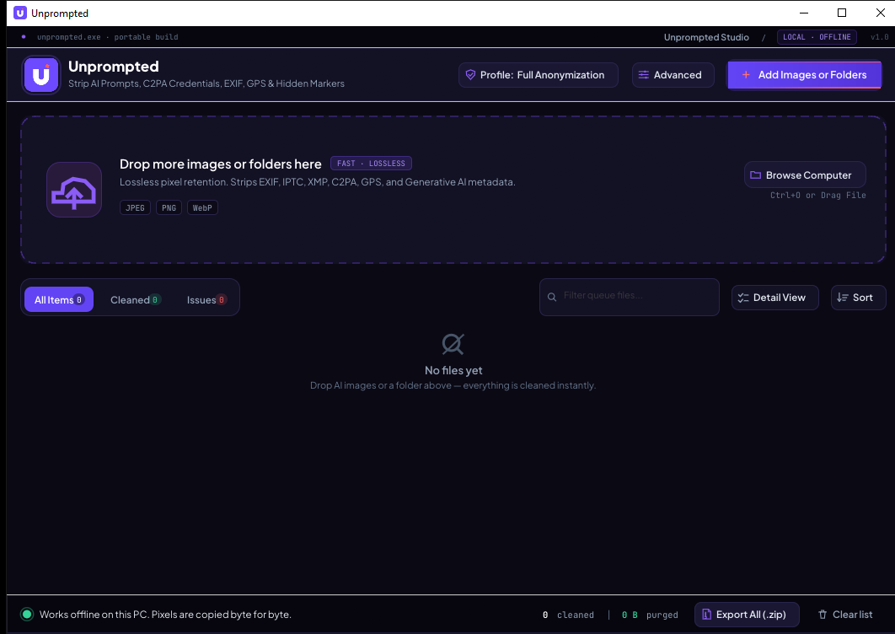
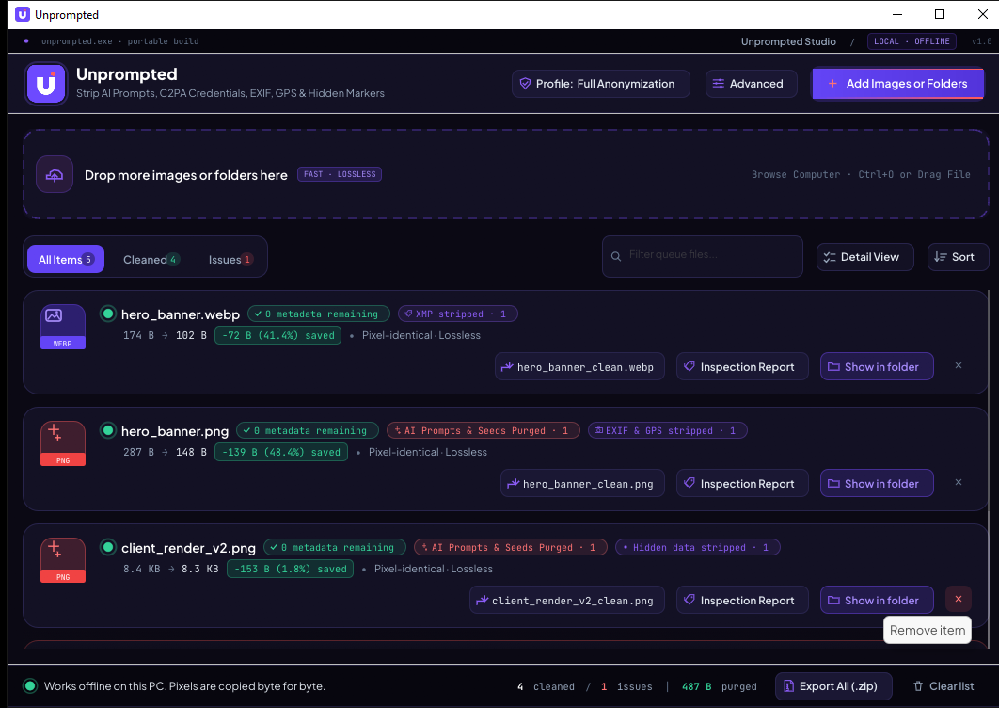

<div align="center">


# Unprompted

**Strip AI prompts, C2PA credentials, EXIF, GPS & hidden markers from images — losslessly.**

A tiny portable Windows app. No installer, no registry, no config files, no cloud.
Drop images on the window, get `<name>_clean.<ext>` next to them. Originals are never touched.

[Features](#features) · [Usage](#usage) · [Scrub profiles](#scrub-profiles) · [Build from source](#build-from-source) · [Project layout](#project-layout)

</div>

---

## What it removes

AI image tools hide a lot inside your files: Stable Diffusion / A1111 prompt blocks, ComfyUI
workflows, C2PA content credentials, EXIF & GPS, XMP, IPTC, PNG comments and more.
Unprompted copies **only the pixel data and known-safe structure** into a fresh file —
everything else is simply not carried over.

| Format | Kept | Purged |
|---|---|---|
| **PNG** | `IHDR`–`IEND` required chunks, pixel data | `tEXt`/`zTXt`/`iTXt` (prompts, workflows), `eXIf`, `iCCP`, unknown/private chunks, trailing garbage |
| **JPEG** | `SOI`, frame/scan structure, image data | `APP1` EXIF & XMP, `APP13` IPTC, `APP11` C2PA (JUMBF), `COM` comments |
| **WebP** | `VP8`/`VP8L`/`VP8X` + canvas chunks | `EXIF`, `XMP ` chunks and their flags |

Output files are **pixel-identical** to the originals — the image data is copied byte for byte,
never re-encoded, never re-compressed.

<div align="center">




</div>

## Features

- **Drag & drop or browse** — drop images or folders onto the window (folder input takes the
  direct children, sorted and de-duplicated), or press <kbd>Ctrl</kbd>+<kbd>O</kbd>.
- **Three scrub profiles** — Full anonymization (default), Keep camera info, Prompts only.
- **Instant cleaning** — every file is cleaned the moment it's added; no queue, no waiting.
- **Inspection report** — expand any card to see exactly which chunks/segments were purged
  and how many bytes each one cost.
- **Collision-safe output** — if `image_clean.png` already exists you get `_clean2`, `_clean3`, …
- **Export all as ZIP** — one click bundles every cleaned file (stored, CRC-verified).
- **Filter, tabs & sort** — All items / Cleaned / Issues tabs, live text filter, sort by
  added / name / size.
- **Headless CLI mode** — `Unprompted.exe --cli` for scripts and batch jobs, with proper exit codes.
- **Truly portable** — single ~5.6 MB exe, static CRT, runs from a memory card.

## Usage

### GUI

Run `Unprompted.exe`. Drag images or folders in, or use the buttons. Everything is cleaned
instantly; use **Export All (.zip)** or grab the `_clean` files from the source folders.

### CLI

```
Unprompted.exe --cli <files-or-folders...>
```

Exit codes: `0` = all files cleaned, `1` = some files failed (missing or unsupported),
`2` = bad usage / no inputs.

```
Unprompted.exe -h          # show help
Unprompted.exe --cli D:\renders D:\shots\img001.png
```

## Scrub profiles

| Profile | What it does |
|---|---|
| **Full anonymization** | Strips everything: AI prompts, EXIF, GPS, XMP, IPTC, C2PA, comments. |
| **Keep camera info** | Keeps the entire EXIF block (camera + dates) so photos stay cataloguable; everything else goes. |
| **Prompts only** | Removes only AI prompts, comments and C2PA credentials — keeps the rest of the metadata block. |

Profiles always keep or drop *whole* metadata blocks, never individual fields — that keeps the
byte-copy approach safe and predictable.

## Build from source

Prerequisites: Rust 1.95+ (stable, either `x86_64-pc-windows-msvc` or `x86_64-pc-windows-gnu`).

```powershell
git clone <this-repo>
cd unprompted
cargo build --release
# exe: target/release/Unprompted.exe
```

Or with the helper script (also refreshes icons from `public/`):

```powershell
powershell -ExecutionPolicy Bypass -File scripts/build.ps1
```

The icon and window logo are embedded at build time (`build.rs` + `winres`); fonts are subset
static TTFs under `assets/fonts/`, included via `include_bytes!`. No runtime downloads, no
dynamic dependencies.

## Testing

```bash
cargo test                       # 25 library + 5 GUI/icon unit tests
python tests/e2e/run_e2e.py      # 42 end-to-end checks against the release exe
python scripts/playtest.py       # interactive UI playtest harness (SendInput + PrintWindow)
```

The e2e suite builds synthetic AI-metadata files (A1111 prompt PNG, ComfyUI workflow PNG,
EXIF+comment JPEG, XMP WebP), cleans them with the real exe, and verifies the metadata is gone,
pixels are untouched, folder inputs work, collisions are handled, and errors exit correctly.

## Project layout

```
├── Cargo.toml               crate manifest (package `unprompted`, bin `Unprompted`)
├── .cargo/config.toml       portable build flags (static CRT for both toolchains)
├── build.rs                 Windows resource embedding (icon + version info)
├── src/
│   ├── lib.rs               core: detect/clean pipeline, profiles, ZIP writer
│   ├── formats/
│   │   ├── mod.rs           format detection, shared error types
│   │   ├── png.rs           PNG whitelist cleaner
│   │   ├── jpeg.rs          JPEG whitelist cleaner
│   │   └── webp.rs          WebP (RIFF) whitelist cleaner
│   ├── main.rs              CLI entry point
│   ├── gui.rs               egui application (window, cards, dialogs, drag & drop)
│   ├── theme.rs             color palette, typography, visual style
│   └── icons.rs             painter-drawn Material-style icon set
├── assets/
│   ├── icon.ico / icon.png  embedded exe & taskbar icons
│   ├── icon256.rgba         window icon at runtime
│   ├── logo.rgba            header logo texture
│   └── fonts/               subsetted Plus Jakarta Sans + JetBrains Mono
├── scripts/
│   ├── build.ps1            release build helper
│   ├── make_icon.py         regenerates icon assets from public/icon-512.png
│   └── playtest.py          human-like UI automation for testing
├── tests/e2e/run_e2e.py     end-to-end suite (42 checks)
├── docs/                    project memory + screenshots
├── mockup/                  original design reference (Stitch redesign showcase)
└── public/                  brand icon source set
```

## Design notes

- **Whitelist, not blacklist.** A cleaner only copies chunk/segment types it can prove are safe;
  anything it doesn't recognise is dropped by default. New obfuscation schemes can't sneak through.
- **Byte-copy safety.** Pixel data and kept blocks are copied verbatim; PNG CRCs are recomputed
  from the copied bytes, WebP (no CRC) is copied as-is, JPEG scan data passes through untouched.
- **Profiles keep blocks whole.** Never half-truncate a metadata segment — partial EXIF could
  still be parsed wrong, so a kept block is kept completely.

## License

MIT — see [LICENSE](LICENSE).
